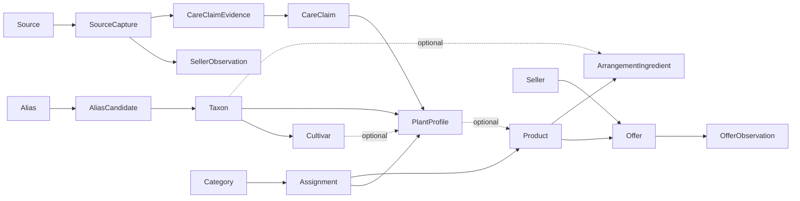

# Knowledge and website blueprint

## What belongs where

| Layer | Record | Practical example |
|---|---|---|
| Botanical identity | Accepted name, rank, taxonomic authority and synonyms | A scientific name can change while the public profile URL stays stable. |
| Local language | Display name, raw aliases, market, normalized search form and ambiguity | سانسوریا and snake plant can lead to several matches; show scientific names or photos to disambiguate. |
| Growing knowledge | Profile and individually sourced care claims | A light recommendation records whether the plant merely tolerates a condition or thrives in it. |
| Editorial discovery | Collections built from sourced traits or curated rules | «گیاهان مناسب نور کم» is a reusable collection; a plant can appear in several collections. |
| Merchandise | Product, variant and seller offer | A plant in a nursery pot and a ceramic pot are variants; stock, city, price and delivery are seller facts. |
| Floristry | Cut stem and arrangement records | A rose stem has vase care; a rose bouquet is a product that may include multiple stems or substitutions. |

Use the following example records as editorial mapping candidates, pending identity verification: پتوس / pothos → *Epipremnum aureum* where the listing identifies that species; سانسوریا / snake plant → *Dracaena trifasciata* where confirmed; برگ‌انجیری / Swiss cheese plant → a disambiguation view that can distinguish *Monstera deliciosa* and *M. adansonii*. Never turn a market label into a species assertion on its own. Keep cultivar names, transliterations and old scientific names as separate alias types.

## Record relationships



Use stable IDs across name revisions. A profile has a taxon and may identify a cultivar. A name can resolve to several profiles, and a category can contain many profiles or products. Keep the raw label and source on each alias. Use a separate symptom-to-cause relation with conditions and evidence so a symptom can return several plausible causes. Arrangement ingredients can carry a trade name even when the species is uncertain. Record quantities and substitutions explicitly when the seller specifies them.

Normalize Persian orthography for retrieval before ranking identity candidates. For «برگ انجیری», show disambiguation across the evidenced candidates. For «بابا آدم», show the unresolved trade name and genus lead. Keep the authority and date on scientific synonym decisions so backbone disagreements can be reviewed without changing profile IDs. Store a preferred candidate as a ranking hint.

Keep evidence status on captures and editorial review status on decisions and care claims. Join each claim to one or more sources with a locator and an evidence relationship such as supports, qualifies, or conflicts. For the pothos pilot, condition-based watering is the draft guidance and the seller's twice-weekly recommendation remains a retail observation. Record animal-specific toxicity separately. Treat dated price, pack size, delivery wording and stock as observations of an offer. For wholesale captures include the stall and grade alongside the raw unit and parsed count.

Store market evidence, botanical identity evidence, and editorial care claims independently. A seller observation may inform a search synonym or a collection, while an editorial care claim needs a horticultural source with matching conditions. Attach rights and attribution information to sources and assets before publication. Keep seller data on dated offers. The [roadmap](research-roadmap.md) defines when each layer enters the release.

### Evidence and release rules from the execution update

Track page retrieval, field availability, archive status, and asset rights independently. Nargil's cart is reported as retrieved while its retail delivery terms remain unavailable. Model the retail, aggregation, and wholesale/project channels explicitly. Record VIPShop's B133 box and K133 basket as distinct products with their own policy terms.

Store translated wording and its review state per locale. Keep the underlying claim and citations shared. Record photo rights per selected image with the exact asset URL, credit, license and changes. The Kew pothos image page is a reported CC BY 3.0 candidate. Select the individual image and record attribution before using it.

Store accepted names as authority-specific treatments of a stable taxon concept. The reported Kew and 2018 treatments of split-leaf philodendron are separate records. An authority identifier supports a taxon name. A vernacular mapping still needs listing or morphology evidence. Keep the bare «برگ انجیری» query ambiguous and «بابا آدم» unresolved. The Alocasia and Colocasia species listed for «بابا آدم» are hypotheses for field checks.

Keep search fixtures separate from device runs and symptom cases separate from reviewed cause links. Treat conditions missing from a symptom case as unknown. For dated wholesale lists, preserve the source calendar, raw unit, count, market and collection method. Online price lists and stall visits contribute different coverage. Comparable records require matching item, grade and selling unit.

Classify «ابلق» as an appearance descriptor and «پنجه شیری» as a trade modifier in the current evidence. Link a modifier to a cultivar only when horticultural evidence supports that link. Attach each identification example to its observed traits and supported rank. A listing with «آلوکازیا» supports genus-level identification within that listing. Species resolution needs additional evidence.

Record symptom onset and progression, light source and exposure, watering method and interval, drainage, substrate and recent changes. Document when photos were taken and who supplied them. Add root and pest observations where available. Anecdotal cases can inform the questions shown to a grower. Publish cause links after evidence review.

## Site structure

```text
خانه / Home
├─ گیاهان آپارتمانی / Houseplants
│  ├─ همهٔ گیاهان / A–Z plant library
│  ├─ انتخاب بر اساس شرایط خانه / Find a plant for your space
│  ├─ مجموعه‌ها / Collections
│  └─ شناسنامهٔ گیاه / Plant profile
├─ راهنمای نگهداری / Plant care
│  ├─ نور، آبیاری، خاک و گلدان / Care fundamentals
│  ├─ مشکلات و آفات / Symptoms and pests
│  └─ تکثیر و تعویض گلدان / Propagation and repotting
├─ گل شاخه‌بریده / Cut flowers [second release]
│  ├─ راهنمای انواع گل / Stem library
│  └─ نگهداری در گلدان / Vase care
└─ فروشگاه / Shop [commerce release]
   ├─ گیاهان، گلدان و ملزومات / Plants, pots and supplies
   ├─ دسته‌گل و گل‌آرایی / Bouquets and arrangements
   └─ مناسبت‌ها و ارسال / Occasions and delivery
```

Make search visible on mobile. Index فارسی, English and scientific names together. Normalize ي/ی and ك/ک, digit variants, diacritics, and spaces or نیم‌فاصله for matching while preserving display text. Redirect only unambiguous names. Show each language under its own path and use RTL layouts for Persian, with isolated LTR spans for scientific names and mixed-script strings. Keep product prices and shipping rules out of the plant profile; show them in a separate local-offer module when there is actual coverage.

**Browse page:** show a photo, common and scientific names, two or three supported care traits, and a comparison action. Begin with light, space/size, care effort and growth habit. Offer pet-related filters only for claims with verified animal-specific evidence; display unknown separately. Define what “easy” means (for example, tolerance of occasional missed watering under stated conditions).

**Profile page:** hero and identity → care at a glance → light, watering, substrate and pot, temperature and humidity → seasonal changes and repotting → symptoms and lookalikes → claim sources and last review → related plants and optional local offers. Distinguish current sellable pot size from expected size indoors. For care, lead with observations and conditions rather than fixed calendar intervals. Troubleshooting should ask about recent changes, drainage, soil moisture and light before proposing likely causes; one symptom can have several causes.

**Commerce pages:** live plants use growing and size filters; arrangements use occasion, format, color, budget, city and delivery date; cut stems use flower name, color and stem count or selling unit. Treat gift collections as curated views. An arrangement can have known components and explicit substitutions. Display the source price unit as تومان or ریال; store the unit explicitly and convert only when verified.

## Literature and editorial method

| Source to consult | Use it for | Editorial boundary |
|---|---|---|
| [Kew Plants of the World Online](https://powo.science.kew.org/) | Accepted names, synonyms and taxon links | Verify the actual taxon record, not just a search match. |
| [RHS houseplants](https://www.rhs.org.uk/plants/types/houseplants) | Houseplant profiles and growing guidance | Record the conditions and scope of each recommendation. |
| [NC State Extension Plant Toolbox](https://plants.ces.ncsu.edu/) | Identification, plant traits and plant profiles | Resolve disagreements against the species and cultivation context. |
| [University of Minnesota Extension houseplants](https://extension.umn.edu/yard-and-garden/houseplants) | Care fundamentals and troubleshooting | Adapt seasonal guidance to the home and local climate. |
| [ASPCA plant toxicity database](https://www.aspca.org/pet-care/animal-poison-control/toxic-and-non-toxic-plants) | Species-specific pet toxicity references | Record the animal species and exact plant ID; a missing listing means unknown. |
| [UC Davis Postharvest Research and Extension Center](https://postharvest.ucdavis.edu/) | Cut flower storage and postharvest reading | Distinguish professional cold-chain protocols from home vase care. |
| [Iranian Research Institute of Plant Protection](https://iripp.areeo.ac.ir/) | Candidate for Persian plant protection literature | Find the actual publication and confirm its scope before citing it in a guide. |

Source status is per page or publication. These are literature starting points; linking an institution alone does not verify a care claim. Retailers are primary evidence for their labels and menus, and local growers can contribute documented observations about growing conditions. Record each published claim with the profile or taxon, topic, conditions, source URL, verification date, editor and review state. Use separate states for draft, reviewed, disputed and retired. If two sources disagree, check whether they use different light conditions, seasons or identities before presenting the difference.

Maintain four reusable assets: source captures or notes; structured observations with source links; a readable current brief; and search views filtered by market, plant or topic. Archive seller observations with dates, because navigation, stock and prices can change. Give authors a correction workflow; review when taxonomy changes or when users flag a conflict.

## Release scope

The first release contains the directory, plant profiles, basic care guides, and multilingual search. Add guided selection and symptom navigation after testing the underlying claims and search tasks. Validate cut stem and arrangement data as separate content types before adding florist navigation. See the [research roadmap](research-roadmap.md) for deliverables and exit criteria.
